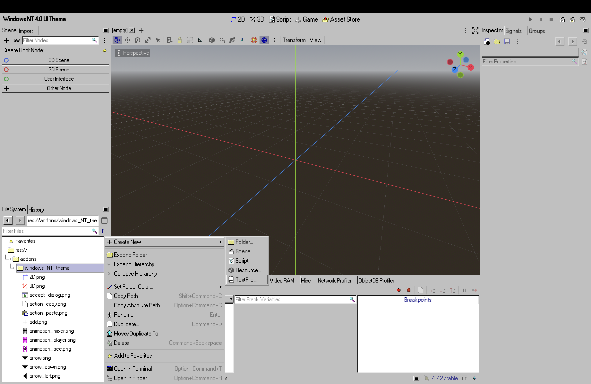

# Godot Windows NT 4.0 UI Theme

A mathematically precise, highly optimized workstation skin that transforms the modern Godot 4 editor layout into a crisp, authentic 1990s Windows NT 4.0 desktop environment. 

## 🖥️ Visual Interface Preview

## 🚀 Key Feature Enhancements
- **100+ Custom Icons:** Over 100+ vintage and meticulously hand-crafted retro pixel art graphics replacing full debugging suites, document nodes, sliders, and sidebar utilities natively.
- **True Corporate Color Palette:** Natively injects a unified, un-shaded `#c0c0c0` gray base window skin with flattened panel highlights (`contrast = 0.0`) for a true vintage look.
- **Pristine Performance:** Typography and style adjustments are nativized into optimized plain-text resource configurations, ensuring instant project load times with zero console warnings or signal breaks.

## 📦 Installation Instructions
1. Download the latest `godot-windows-nt-theme.zip` package from the **Releases** tab on the right.
2. Extract the archive and place the `windows_NT_theme` folder directly into your project's `res://addons/` directory.
3. Open your Godot editor, navigate to **Project -> Project Settings -> Plugins**, and toggle the `WindowsNTTheme` status checkbox to **Enabled**.
